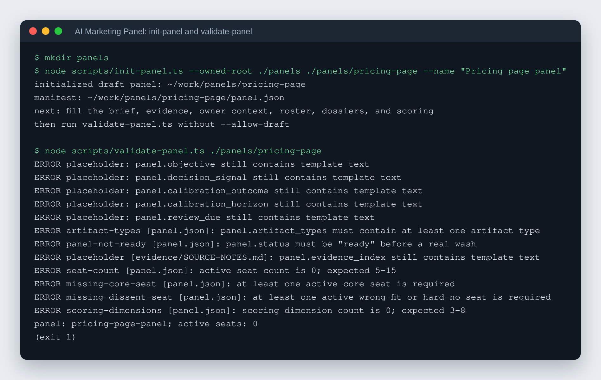

# AI Marketing Panel

Test a landing page, price or email on a panel of researched customer composites before it reaches real customers.

[](LICENSE)


## What it is

A synthetic customer panel is a room full of researched stand-ins for your
actual customers. You describe a real decision (should this landing page go
live, does this price make sense, will this email get opened) and the kit
builds five to fifteen distinct customer composites from evidence you already
have: support tickets, sales calls, reviews, the things people say when they
turn you down. Each composite gets a long, sourced dossier, and then each one
reads your draft alone, in its own context, without seeing what any of the
others said. You get back their separate reactions, a synthesis that keeps the
disagreements intact, and a scored verdict you can argue with.

The kit is an agent skill (`skills/synthetic-customer-panel/`) for Claude or
Codex, plus deterministic TypeScript validators that decide whether a panel and
a run meet the standard. The model does the reading and writing; the scripts
do the checking.

## Why it exists

It is for the owner or the small team who writes their own copy and has nobody
to show it to before it ships. Commissioned focus groups cost real money and
take weeks, so most small businesses skip the test and go on instinct. This
gives the people who write the page a structured critique before customers see
it instead of after. It is directional evidence, not customers, and the kit
says so everywhere it matters.

| | Commissioned focus group | This kit |
| --- | --- | --- |
| Cost | roughly $20,000 and up | a few dollars of model usage |
| Turnaround | weeks | about ten minutes |
| What you get | real customers | researched composites |

**Both figures are unmeasured estimates, not measured results.** The $20,000
figure is an order of magnitude for a commissioned focus group and moves a lot
by scope and market. The per-run cost varies with the model, the number of
active seats and the length of the artifact. Anyone quoting these to a client
should price their own run first. The last row does not favour the kit: these
are composites, not customers. What the kit buys is the ability to run the test
at all, at a price where testing every artifact is a habit rather than a budget
decision.

## How it works


`init-panel.ts` copies a neutral workspace template into a folder you own,
with a `panel.json` manifest, a brief, evidence notes and a dossier template.
You fill in the decision, the customer evidence and 5-15 seats, each with its
own dossier; `validate-panel.ts` refuses the panel until there is a decision,
first-party evidence, enough seats, at least one wrong-fit or hard-no seat and
3-8 scoring dimensions. `prepare-run.ts` copies the artifact into a new run
folder and stages one task per seat, each seat reacts in an isolated context, and the
synthesis and score are written as separate stages. `validate-run.ts` checks
the finished run, and `room.sh` archives it and resets the room for the next
artifact.



*Real output: `init-panel.ts` creating a draft panel and `validate-panel.ts`
refusing it until the brief, evidence, seats and scoring are filled in.*

## Features

1. Defines the decision and the customer evidence before anything runs.
2. Builds an explicit panel of 5-15 customer composites in `panel.json`.
3. Produces one evidence-labeled dossier per seat, checked for length,
   thin sections and near-duplicates.
4. Runs each seat independently against the same artifact.
5. Synthesizes reactions without erasing dissent.
6. Scores the artifact with owner-approved weights.
7. Produces three rewrites and retests when useful.
8. Records predictions and later real outcomes for calibration.
9. Named rooms: build a panel once, `clean` it, and run the next artifact.

The quality of the dossiers is the product. Prompts alone are not a panel.

## Quick start

Requires Node 22.18.0 or later for the validators; `room.sh` needs only bash.

```bash
git clone https://github.com/rodaddy/ai-marketing-panel.git
cd ai-marketing-panel
bash skills/synthetic-customer-panel/scripts/check-node.sh
```

Then install the skill into your agent. The kit zip is this folder zipped
(no release asset ships one; GitHub's Code > Download ZIP gives the same
files). In the Claude app, drag the kit zip into the conversation; in Codex,
unzip the kit to a folder and point Codex at it. Start with [START-HERE.md](START-HERE.md); the full agent-run install
contract is [INSTALL.md](INSTALL.md) and the plain-language guide is
[OPERATIONS-MANUAL.md](OPERATIONS-MANUAL.md). Ask the agent to "build a
customer panel" or "wash this artifact".

To run the validators by hand:

```bash
mkdir panels
node skills/synthetic-customer-panel/scripts/init-panel.ts \
  --owned-root ./panels ./panels/my-panel --name "My panel"
node skills/synthetic-customer-panel/scripts/validate-panel.ts ./panels/my-panel
```

Do not run the kit in place. Make an owned copy for each use, evolve that copy
through real work, and promote only validated general improvements back.

## Install per harness

| Harness | Install | Status |
| --- | --- | --- |
| **Claude app** | Drag-and-drop the kit zip into the conversation. | VERIFIED working 2026-08-12 |
| **Codex** | Unzip the kit to a folder, then point Codex at that folder. | VERIFIED working 2026-08-12 |
| **claude.ai web** | Presumed zip upload, same as the app. | **UNVERIFIED** — never tested. |

The web row stays UNVERIFIED until a human actually runs it. When somebody
does, this row changes and `CHANGELOG.md` records who and when.

## Capability tier ladder

This kit is written against **T1** and degrades to T2 and T3 on announcement,
never silently. Every run records the tier it actually ran at in `RUN.json`.

**T1 — full** (subagents + workflow orchestration; Claude Code today). Seats
run as **subagents running workflows**, one subagent per seat, at most seven
per wave. Parallel rooms, full `room.sh` lifecycle, deterministic validators,
isolated per-seat execution. Mode `isolated-parallel`. This is the tier the
headline claims above are written against.

**T2 — shell-only** (can execute scripts, cannot orchestrate subagents).
`room.sh`, the room lifecycle, and the validators all work. Seats run
**sequentially in separate fresh contexts** — mode `isolated-sequential`. This
is a full-fidelity run, not a degraded one; what is lost is wall-clock time and
cross-seat isolation strength, and the run is labeled `isolated-sequential`
rather than parallel.

**T3 — chat-only** (no shell; claude.ai web, ChatGPT). The kit degrades to
prompts and templates: every deterministic script becomes a manual checklist
walked by hand. **What is LOST at T3:** script-enforced gates become advisory;
`validate-panel` / `prepare-run` / `validate-run` become self-report instead of
verdicts; `room.sh` archiving becomes manual file hygiene; the
"the script decides, not the AI" guarantee is downgraded to a convention; and
if contexts cannot be isolated at all the run is `sequential-shared-context`
and is labeled degraded. Seats are still run one at a time from the task
templates, each reaction frozen before the next dossier is loaded.

### T2 dependency floor

- `skills/synthetic-customer-panel/scripts/room.sh` is the floor: bash and
  coreutils only, no jq, no Python, no Node, no install step. It parses on
  Apple's stock bash 3.2.
- **Node 22.18.0+ is a stated T2 REQUIREMENT for the panel validators.**
  `init-panel.ts`, `validate-panel.ts`, `prepare-run.ts`, `validate-run.ts`,
  and `verify-install.ts` are TypeScript and are invoked with plain `node`,
  which runs them directly — no flags, build step, bundler, or `npm install`.

  Check the floor with the kit's own preflight, which needs only bash and
  prints the upgrade action for your system if you are short:

  ```
  bash skills/synthetic-customer-panel/scripts/check-node.sh
  ```

  **If you are on Node 22.6–22.17 you are BELOW this floor and must upgrade.**
  Node 22.6 was this kit's floor through release 1.2.1; 1.2.2 raised it because
  Node only reads the kit's TypeScript without a flag from 22.18.0 up. Below
  22.18.0 the validators stop with a syntax error rather than running. Install
  the current LTS from https://nodejs.org/en/download — on macOS with Homebrew,
  `brew install node`; on Linux, your distribution's Node packages.

  Without Node at or above the floor the room lifecycle still works
  (`room.sh` needs only bash), but panel and run validation drops to the T3
  self-report path, and a self-reported panel is labeled as such.

## Package

- `START-HERE.md` — first handoff file.
- `INSTALL.md` — canonical agent-executed installation contract.
- `kit.json` — declared requirements, payloads, boundaries, and verification.
- `kit.schema.json` — standalone manifest schema.
- `VERSION` — source-of-truth package version.
- `CHANGELOG.md` — released PoC changes.
- `installer.md` — compatibility pointer for the original installer filename.
- `OPERATIONS-MANUAL.md` — plain-language operator guide.
- `skills/synthetic-customer-panel/` — portable skill, workflows, standards,
  deterministic scripts, and workspace templates.
- `skills/synthetic-customer-panel/KIT-METADATA.json` — installed kit identity,
  version, and payload digest manifest.
- `verify-copied-install.ts` — source-side byte-for-byte comparison of the
  retained source payload and a copied destination.
- `skills/synthetic-customer-panel/scripts/verify-install.ts` — deterministic
  metadata and non-verifier file check to run from the copied payload.
- `skills/synthetic-customer-panel/scripts/check-node.sh` — bash-only Node
  floor preflight; prints the upgrade action when the machine is short.
- `tests/` — behavior tests for initialization, validation, run preparation,
  and completed-run validation.

## Development verification

The panel tools are TypeScript and run with plain `node`. Python and `uv` are
not needed. The dependencies below are development-only types:

```bash
npm install && npm run check
```

## Installed-payload verification

After copying `skills/synthetic-customer-panel/` to its persistent destination,
keep this source kit available and run:

`node verify-copied-install.ts "<copied-destination>"`

It compares the retained source payload and the copy byte-for-byte, including
`KIT-METADATA.json` and `scripts/verify-install.ts`, and rejects symlinks,
non-files, missing files, and extras. Then run this command from the copied
directory:

`node scripts/verify-install.ts`

It checks its embedded metadata expectations and the file set and SHA-256
digests of every metadata-listed non-verifier file. It cannot authenticate its
own bytes; rerun retained-source `verify-copied-install.ts` to cover the
installed verifier. Neither mechanism authenticates a publisher or acts as a
cryptographic signature.

## How it was built

The kit went from 1.0.0 to 1.2.3 in seven releases between 2026-07-16 and
2026-08-17, built by AI coding agents with a deterministic validator for every
step a script can check, and hardened by a review from a second model family.
The build story covers each release, the design decisions, the tests, and what
had to be corrected along the way: [docs/BUILD-STORY.md](docs/BUILD-STORY.md).

## Project status

Active, version 1.2.3 (see [CHANGELOG.md](CHANGELOG.md)). Verified working in
the Claude app and in Codex; claude.ai web is untested. The panel is a
structured directional signal. It is not a substitute for real customers,
legal review, accessibility testing, usability testing, analytics or market
evidence, and its value becomes defensible only through calibration against
real outcomes.

## Licence

MIT. See [LICENSE](LICENSE).

## Credits

The synthetic focus-group method follows the workflow demonstrated in Corey
Ganim's interview with Justin Brooke. This repository is an independent,
audience-neutral implementation of it.

## Author

Rico Rojas, https://rico-rojas.com. Hosted install and tuning are available
through rTech Digital Consulting, https://rtech-consulting.com.
